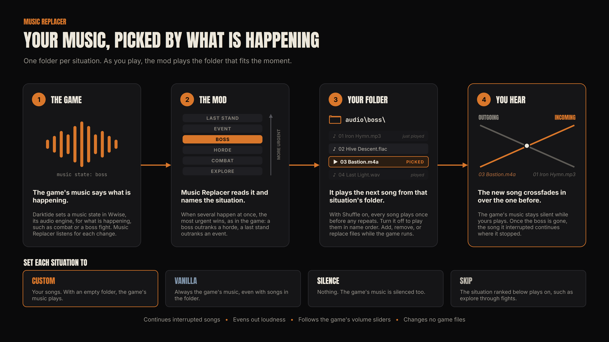

# darktide-music-replacer

Music Replacer is a mod for Warhammer 40,000: Darktide that plays your own music in place of the game's, chosen by what is happening in the hub or a mission. You put audio files into folders, one folder per situation, and the mod picks the right one as you play. Wherever you add no songs, the game's music plays as usual.

Download it from [Nexus Mods](https://www.nexusmods.com/warhammer40kdarktide/mods/1464).

## Quickstart

1. Install Music Replacer like any other Darktide mod, by hand or through a mod manager such as Vortex. It needs [Darktide Mod Loader](https://www.nexusmods.com/warhammer40kdarktide/mods/19) and [DMF](https://www.nexusmods.com/warhammer40kdarktide/mods/8), with `MusicReplacer` listed below `dmf` in `mod_load_order.txt`.
2. Put your songs into the folders you want music for, inside the **installed** mod folder: `...\Warhammer 40,000 DARKTIDE\mods\MusicReplacer\audio\`. It comes with one folder per situation. Most people start with `hub`, `explore`, `combat`, `horde`, and `boss`. Wherever you add no songs, the game's music plays as usual.
3. Start the game and play.

That is all it takes. A few things to know:

* The formats that work are `.mp3`, `.m4a`, `.aac`, `.wav`, `.flac`, and `.wma`. Other files, such as `.ogg` and `.opus`, are ignored, so convert those to a supported format first. File names in any language work.
* You can add, remove, or replace files while the game runs, and the mod picks them up by itself 3 seconds after files stop changing. A song that is playing finishes, even if you remove its file, and if it was a folder's only song, it keeps looping until the music changes.
* Put songs directly inside the folders. Folders inside them are [override folders](docs/override-folders.md), which are optional. If a situation's folder goes missing, the mod creates it again when the game starts or when you press Rescan Audio Folders.
* Every folder and when it plays is listed under [Where your music plays](#where-your-music-plays).

Everything below is optional detail.

## Common setups

| I want to… | Do this |
|---|---|
| …keep the game's music in one situation. | Leave its folder empty, or set it to Vanilla under Music per Situation in the mod options. |
| …have no music at all in one situation. | Set it to Silence under Music per Situation. |
| …hear one song through a whole mission without it starting over. | Put a copy of that one file, and nothing else, into each folder you want it in, such as `explore`, `combat`, `horde`, and `boss`. |
| …give one kind of boss its own music. | Make a folder named after the boss inside `boss`, such as `boss\chaos_spawn\`. [Override folders](docs/override-folders.md#folder-names) lists every name. |
| …give one mission its own music. | Make a folder named after the mission's code inside the folders you want, such as `explore\spillway\` and `combat\spillway\`. [game-internals.md](docs/game-internals.md) lists every mission's code. |
| …give an Operation its own music. | Make `event\op_train\` for Rolling Steel or `event\op_no_mans_land\` for No Man's Land, since Operations play `event` all the way through. |
| …find out which folder plays right now. | Turn on Debug Overlay in the mod options. It shows the folder that plays and the override names the moment looks for. |
| …try out my songs without starting a mission. | In Meat Grinder, set its Music to One Situation and pick the situation. |
| …skip a song, or never hear it again. | Bind Next Song or Remove from Rotation under Playback Controls in the mod options. |
| …see which song is playing. | It shows by default: each new song's name appears for a few seconds in the bottom left corner. The On-Screen Messages group in the mod options turns it off or changes its size, color, and position. |

## What it does

* Plays your songs by situation: the title screen, character select, the hub, loading screens, exploring, combat, hordes, bosses, events, last stands, victory, defeat, Mortis Trials, Expeditions, and Meat Grinder.
* Picks a random song from a folder with several, never the one that just played.
* Loops a folder's only song seamlessly, with no gap added between its end and its start.
* Keeps a folder's only song playing when the next situation's folder also holds only that song, instead of starting it over.
* Crossfades when the situation changes, and fades a song out at its end.
* Continues a song from where it stopped once its situation comes back, such as explore music after a fight.
* Follows the game's master and music volume sliders at once, without restarting the song.
* Lets you choose Custom, Vanilla, or Silence for each situation.
* Lets you try out any situation's songs in Meat Grinder, or play a folder of its own there.
* Has optional keys to skip to the next or previous song, restart or pause the song playing now, or remove it from rotation.
* Names each new song, and what each key did, in a short message in a corner of the screen, on every screen, loading screens included.
* Can even out the loudness of your songs, without changing your files.
* Lowers your music while a menu is open.
* Has a debug overlay that shows which situation the mod sees and what it plays.
* Picks up added, removed, and replaced files while the game runs.

## What it does not do

* It does not change sound effects or voice lines, only the music.
* It does not affect your squadmates. They hear their own game's music.
* It does not play your music during mission intros and cutscenes. The game's music plays there.
* It does not download or stream anything. It plays only the files in its own audio folders.

## How it plays your music

Music Replacer needs no FFmpeg, no extra program, and no other mod beyond the mod loader and DMF. It plays your songs inside the game itself, through two parts of Windows: Media Foundation, Windows' own media framework, decodes the files, and XAudio2, the audio engine Windows provides for games, plays them. That is what lets it crossfade, follow the volume sliders, and lower the music in menus without ever restarting a song. The [development notes](docs/development.md#why-the-mod-uses-windows-own-audio) explain why.

## Requirements

* [Darktide Mod Loader](https://www.nexusmods.com/warhammer40kdarktide/mods/19).
* [Darktide Mod Framework](https://www.nexusmods.com/warhammer40kdarktide/mods/8) (DMF).
* `MusicReplacer` listed below `dmf` in `mod_load_order.txt`, in the game's `mods` folder.

Windows "N" editions leave out Media Foundation, so on one, install Microsoft's free Media Feature Pack, which adds it. Without it, the mod cannot play your songs, and the game's music plays as usual.

## Where your music plays

The folders most people fill first are in bold. Each folder plays in one situation. The music switches about half a second after the situation changes, so a moment that flickers does not restart the song. Into a loading screen, other than the briefing after the preparation screen, it waits 3 seconds, and so does the first situation after a loading screen, other than the hub and the preparation screen. The Music Holds settings also keep combat, horde, boss, and event music going for a few seconds, so a short lull does not switch the music at once.

| Folder | When it plays |
|---|---|
| `title_screen` | On the title screen, before character select. |
| `character_select` | On the character select screen, also while you create a character. |
| **`hub`** | In the Mourningstar. |
| `loading` | On loading screens that lead anywhere but into a mission: after starting the game, after a mission, and on the way to Meat Grinder. |
| `mission_preparation` | On the mission preparation screen of every game mode, where the party gathers before a mission and can still change loadouts. |
| `mission_briefing` | On the loading screen before the preparation screen and in the briefing on the way into a mission, and on the loading screen when you join a mission in progress. A song that starts on the loading screen before the preparation screen continues in the briefing after it, unless Resume Songs is off. The mission's intro keeps the game's music. |
| **`explore`** | In a mission while nothing threatens you. |
| **`combat`** | In a mission while enemies attack you, outside a horde or a boss fight. |
| **`horde`** | During a horde. |
| **`boss`** | While a monstrosity is near you, such as a Chaos Spawn, a Beast of Nurgle, a Plague Ogryn, or an Ogryn Houndmaster. This is when the game plays its own boss music. Captains and angered daemonhosts get boss music only with their settings on. A scripted boss, such as Rodin Karnak in Spillway, gets no boss music, since the game does not report it as a boss. |
| `event` | While a mission event plays its music, such as a holdout, a hacking event, an escape, or a scripted boss fight like those in Spillway. It outranks boss, horde, combat, and explore music, as the game's event music does. In Operations, such as Rolling Steel and No Man's Land, it plays for the whole mission, since the game scripts their music from start to end. The prologue, Tancred Bastion, scripts its music the same way, so it mostly plays this folder too. |
| `last_stand` | While only one player of the team is left alive. It outranks events, Mortis Trials waves and breaks, the Expedition extraction, bosses, hordes, combat, and explore. Victory and defeat still take over. |
| `victory`, `defeat` | From the moment a mission is won (`victory`) or lost (`defeat`) until the loading screen or a cutscene. It covers the closing shot of the mission and the score screen after it. |
| `mortis_trials_wave` | In Mortis Trials, during a wave or an objective round, through to the final win. Bosses, hordes, and fights do not interrupt it, since nearly every wave brings bosses. A last stand still takes over. |
| `mortis_trials_break` | In Mortis Trials, between waves. |
| `expedition_combat` | During a fight in an Expedition. Expeditions play this folder in place of `combat` and `horde`. |
| `expedition_safe_room` | In an Expedition's safe room. |
| `expedition_extraction` | While an Expedition's extraction runs, until the mission is won or lost. Only a last stand takes over. |
| `meat_grinder` | In the Meat Grinder training area, with Meat Grinder Folder chosen, as [Meat Grinder](#meat-grinder) explains. |

In Mortis Trials, the two Mortis Trials folders replace the mission folders from `explore` to `event`. In an Expedition, quiet moments play `explore`.

## Choosing what plays

The Music per Situation group has one dropdown per folder above, named after it, except `meat_grinder`. Each offers the same three choices:

| Choice | What plays |
|---|---|
| Custom | Your songs from the situation's folder. With an empty folder, the game's music plays. This is the default. |
| Vanilla | Always the game's music, even with songs in the folder, so you can turn one situation off without moving files. |
| Silence | Nothing. The game's music is silenced too. |

A changed choice applies at once, even to the situation that is playing.

## Meat Grinder

Meat Grinder is a good place to try out your songs, so it has a settings group of its own. Its Music setting offers four choices:

| Choice | What plays |
|---|---|
| Silence | Nothing, as in the game. This is the default. |
| Meat Grinder Folder | Your songs from the `meat_grinder` folder, through every fight with the dummies, so trying out loadouts does not switch the song. With an empty folder, the game's music plays, which is none there. |
| One Situation | The situation you pick under Situation, as if it were happening, to try out its songs. It plays by its own choice in Music per Situation, and with Boss, a boss dummy plays the `boss` override folder named after its breed. |
| Like a Mission | The mission situations, as the game reports them: explore, combat while you hit the dummies, and boss while a boss dummy is alive. Since Darktide 1.13.0, the boss dummies stand in Meat Grinder from the start, so boss music plays for as long as one of them is still alive. It works best with a mod that gives you control over the dummies. |

## Settings

The settings are in the in-game mod options under Music Replacer, in ten groups: Your Songs, Playback, Playback Controls, Volume, On-Screen Messages, Music per Situation, Meat Grinder, Boss Music, Music Holds, and Debug. Every setting and its default is explained in [docs/settings.md](docs/settings.md).

## Override folders

Override folders are optional and for advanced use. A folder can hold folders of its own, which play for a moment inside its situation, such as a kind of boss or the score screen, for a mission, or for a game mode. They are explained in [docs/override-folders.md](docs/override-folders.md).

## Safe by design

* **No game files are changed.** The mod creates its own audio folders and writes files only to its own folder in `%APPDATA%`.
* **No extra programs or DLLs.** The mod uses the audio decoder and audio engine that come with Windows.
* **The game's music is the fallback.** The game's music plays wherever the mod has no songs, cannot play them, or cannot start Windows audio at all. It also plays when a game update reports a music state the mod does not know yet, instead of your songs silencing something new. The game's music is only silenced once one of your songs is ready to play, or where you chose Silence.
* **Broken files are skipped.** A file Windows cannot decode is skipped once the mod has checked it, shortly after launch, and the log names it. If three songs in a row from one folder fail to play, that folder gives way to the game's music until the game restarts or the folders are listed again. An override folder gives way to its parent folder instead.
* **Easy to turn off.** You can turn the mod off in the mod options at any time, and the game's music comes back at once.
* **Your music files are never changed.** The mod only reads them.
* **It stops with the game.** The music plays inside the game itself, so it stops when the game closes, even after a crash.

What the mod writes where, and how it handles a lost audio device, are covered in [docs/troubleshooting.md](docs/troubleshooting.md).

## Updating and uninstalling

Your songs survive updates, even through Vortex, since the mod archive holds only the empty audio folders, never songs, and Vortex only removes files it deployed itself. To update by hand, extract the new version over the old mod folder instead of deleting it first. Renaming the mod folder leaves your songs behind, so move `audio\` across by hand if that ever happens.

Uninstalling the mod leaves its own files in `%APPDATA%\Fatshark\Darktide\MusicReplacer\` behind. Delete that folder by hand if you want them gone. Check `mods\MusicReplacer\audio\` in the game folder too, since your songs were never part of the mod archive.

## Compatibility

* Running Music Replacer alongside other music mods has not been tested.
* The mod has not been tested on Steam Deck or Linux. There the game runs through Proton, which brings its own stand-ins for the Windows audio decoder and audio engine the mod uses. If the mod cannot start them, the game's music plays as usual.
* The mod writes `diagnostic.log`, `loudness.txt`, and `removed.txt` to your `%APPDATA%` folder, and finds it through Windows' "Language for non-Unicode programs" setting. If your Windows username has letters outside that language, such as Japanese letters on an English Windows, those files cannot be written. Your music still plays, Even Out Loudness measures your songs again at every launch, and songs removed from rotation come back at the next launch.

## Troubleshooting

Fixes for common problems are in [docs/troubleshooting.md](docs/troubleshooting.md). To report a problem, open an [issue](https://github.com/Lempki/darktide-music-replacer/issues) and attach the two log files that [Reporting a problem](docs/troubleshooting.md#reporting-a-problem) names.

## Contributing

* Fixes, ideas, and bug reports are welcome, as pull requests or [issues](https://github.com/Lempki/darktide-music-replacer/issues). For a bug, attach the files listed under [Reporting a problem](docs/troubleshooting.md#reporting-a-problem).
* Translations are very welcome too, as pull requests. [docs/development.md](docs/development.md) explains where the texts live and how to add a language.

## Credits

* [Darktide Mod Loader](https://www.nexusmods.com/warhammer40kdarktide/mods/19) and [Darktide Mod Framework](https://www.nexusmods.com/warhammer40kdarktide/mods/8), which this mod builds on.
* [Audio Plugin](https://www.nexusmods.com/warhammer40kdarktide/mods/196) and [Darktide Local Server](https://www.nexusmods.com/warhammer40kdarktide/mods/211), which early versions of this mod played their music through.
* [Simple Audio](https://www.nexusmods.com/warhammer40kdarktide/mods/929) and [Darktide DJ - Music Picker and Shuffler](https://www.nexusmods.com/warhammer40kdarktide/mods/1118), whose takes on custom and situational music inspired this mod.

## More documentation

* For players:
  * [Settings](docs/settings.md): every setting, its default, and the debug overlay's lines.
  * [Override folders](docs/override-folders.md): songs for a moment inside a situation, such as a kind of boss or the score screen, for a mission, or for a game mode.
  * [Troubleshooting](docs/troubleshooting.md): fixes, reporting a problem, the files the mod writes, and a lost audio device.
* For reading the log:
  * [Wwise music states and events](docs/wwise-events.md): the game's music states, how the mod silences them, and tracing a sound.
  * [Game missions and modes](docs/game-internals.md): how the game reports its missions and modes.
* For developers:
  * [Development](docs/development.md): building, testing, how playback works, the project structure, and the roadmap.
